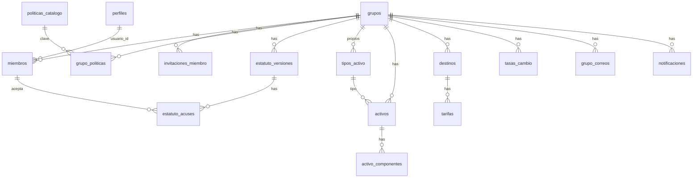

# MODELO DE DATOS — Shared

Nombres de tablas y columnas en español. PK `id uuid default gen_random_uuid()`, `creado_en timestamptz default now()`. **RLS en todas.** Fecha: 2026-11-23. Los bloques marcados **[P1]** se implementan en PROMPT-1; **[P2…P5]** son diseño para prompts posteriores (para que nada del PPT quede sin lugar).

## 0. Tipos y helpers [P1·F2]
Enums: `rol_miembro` (`socio`,`admin_operativo`,`capitan`,`mediador`) · `estado_miembro` (`invitado`,`activo`,`inactivo`,`salido`) · `estado_grupo` (`formacion`,`activo`,`archivado`) · `estado_invitacion` (`pendiente`,`aceptada`,`cancelada`,`expirada`) · `estado_version` (`pendiente`,`vigente`,`reemplazada`,`rechazada`) · `estado_activo` (`borrador`,`activo`,`inactivo`).
Extensiones: `btree_gist`, `pgcrypto`, `citext`, `pg_cron` (condicional).
Helpers `security definer stable`, `search_path = public, pg_temp`: `es_miembro(g)`, `rol_en(g)`, `es_socio(g)`. Utilidades: `auditar()`, `politica(g, clave)`, `politica_validar(clave, valor)`, `tipo_activo_validar(def)`.

## 1. Identidad y gobierno [P1·F2]
| Tabla | Columnas clave | Constraints / índices | RLS |
|---|---|---|---|
| `perfiles` | `id` (= `auth.users.id`), `nombre`, `correo citext`, `telefono`, `idioma` (`es`/`en`) | trigger `on auth.users insert` crea perfil | select: yo, y los que comparten grupo conmigo; update: yo |
| `grupos` | `nombre`, `moneda char(3)` (DOP), `zona_horaria`, `prefijo`, `estado`, `modo_demo bool`, `creado_por` | `moneda ~ '^[A-Z]{3}$'`; `prefijo ~ '^[A-Z]{2,5}$'`; trigger diferido: si `estado='activo'` ⇒ Σ`porcentaje` de socios activos = 100 | select: `es_miembro`; insert/update solo vía RPC |
| `miembros` | `grupo_id`, `usuario_id`, `rol`, `porcentaje numeric(5,2)`, `estado`, `desde`, `hasta` | `unique(grupo_id, usuario_id)`; `porcentaje between 0 and 100`; solo `socio` puede tener `porcentaje>0`; **constraint trigger diferido**: Σ porcentaje socios activos = 100 si el grupo está `activo`, ≤ 100 si no | select: `es_miembro`; escritura solo RPC |
| `invitaciones_miembro` | `grupo_id`, `correo citext`, `rol`, `porcentaje`, `token_hash`, `estado`, `expira_en`, `invitado_por`, `aceptada_por` | `unique(grupo_id, correo) where estado='pendiente'`; token guardado hasheado (sha256) | select: socios del grupo y el invitado por correo; escritura RPC |
| `politicas_catalogo` | `clave pk`, `categoria`, `tipo`, `valor_defecto jsonb`, `minimo`, `maximo`, `opciones jsonb`, `df`, `descripcion` | seed generado desde JSON | select: autenticados |
| `grupo_politicas` | `grupo_id`, `clave`, `valor jsonb`, `version_id` | `pk(grupo_id, clave)`; `politica_validar(clave, valor)` en CHECK-trigger | select: `es_miembro`; escritura solo `aplicar_version()` |
| `estatuto_versiones` | `grupo_id`, `numero`, `estado`, `cambios jsonb {clave: valor}`, `motivo`, `propuesta_por`, `vigente_desde` | `unique(grupo_id, numero)`; a lo sumo 1 `vigente` por grupo (índice parcial); cambios validados | select: `es_miembro`; insert RPC `proponer_cambio_politica` (socio) |
| `estatuto_acuses` | `version_id`, `miembro_id`, `acepta bool`, `momento` | `unique(version_id, miembro_id)`; solo socios activos | select: `es_miembro`; insert RPC (cada quien el suyo) |
| `errores_cliente` | `usuario_id`, `grupo_id`, `mensaje`, `pila`, `ruta`, `agente`, `meta jsonb`, `momento` | límite de tamaño del texto | insert: autenticado (propio); select: propio |
| `notificaciones` | `grupo_id`, `usuario_id`, `tipo`, `titulo`, `cuerpo`, `datos jsonb`, `canal` (`app`,`correo`), `estado_envio`, `motivo_fallo`, `reintentos`, `leida_en` | índice `(usuario_id, leida_en)` | select/update(leida_en): destinatario; insert: RPC/edge |
| `auditoria` | `id bigserial`, `tabla`, `registro_id`, `grupo_id`, `accion`, `antes jsonb`, `despues jsonb`, `actor`, `momento`, `motivo` | **append-only** (trigger + revoke) | select: `es_socio(grupo_id)`; **sin** insert/update/delete directos |

RPC [P1]: `crear_grupo(nombre, moneda, zona, prefijo, porcentaje)` · `invitar_miembro(grupo, correo, rol, porcentaje) → token` · `aceptar_invitacion(token)` (activa el grupo cuando Σ=100) · `proponer_cambio_politica(grupo, cambios, motivo)` · `aceptar_version(version, acepta)` · `aplicar_version(version)` (interna).

## 2. Activos configurables [P1·F4]
| Tabla | Columnas clave | Constraints | RLS |
|---|---|---|---|
| `tipos_activo` | `grupo_id` (null = sistema), `clave`, `nombre`, `es_sistema`, `clonado_de`, `definicion jsonb`, `prefijo_orden`, `version` | `unique(grupo_id, clave)`; CHECK `tipo_activo_validar(definicion)`; trigger: sistema inmutable | select: sistema a todo autenticado, propios a `es_miembro`; escritura `es_socio` (no sistema) |
| `activos` | `grupo_id`, `tipo_id`, `nombre`, `capacidad_legal int`, `valores jsonb`, `punto_encuentro`, `reglas_invitados`, `contacto_invitados`, `estado` | CHECK `estado<>'activo' or capacidad_legal>0`; `valores` validado contra el tipo | select `es_miembro`; escritura `es_socio` |
| `activo_componentes` | `activo_id`, `clave`, `etiqueta`, `indice`, `unidad`, `lectura_inicial numeric(12,1)` | `lectura_inicial >= 0`; `unique(activo_id, clave, indice)` | como activos |
| `destinos` | `grupo_id`, `nombre`, `activo bool`, `orden` | `unique(grupo_id, nombre)` | select `es_miembro`; escritura `es_socio` (admin_operativo no) |
| `tarifas` | `grupo_id`, `destino_id`, `tipo` (`fee_destino`,`hora`), `monto numeric(14,2)`, `moneda`, `vigente_desde`, `vigente_hasta` | `monto >= 0`; sin traslape por (destino, tipo) | select: **solo `socio`** (el invitado y admin no ven tarifas) |
| `tasas_cambio` | `grupo_id`, `fecha`, `de`, `a`, `tasa numeric(18,6)` | `tasa > 0` | `es_socio` |
| `grupo_correos` | `grupo_id`, `correo`, `tipo` (`ordenes`,`alertas`,`invitados`), `activo` | `unique(grupo_id, correo, tipo)` | `es_socio` |

`definicion` (jsonb validado): `campos[] {clave, etiqueta, tipo(texto|numero|fecha|booleano|opcion), obligatorio, unidad?, opciones?}` · `componentes[] {clave, etiqueta, cantidad_defecto, medidor{tipo(horometro|odometro), unidad}}` · `checklists {salida[], regreso[], seguridad[]}` con `{clave, texto, obligatorio}` · `categorias_gasto[]` · `terminologia {activo, salida, responsable}` · `limites_capacidad {socio, invitado}`.

## 3. Reservas y 911 [P2] (diseño)
`reservas` (`activo_id`, `rango tstzrange`, `estado`, `uso`, `destino_id`, `responsable_*`, `personas`, **EXCLUDE USING gist (activo_id WITH =, rango WITH &&) WHERE estado in ('confirmada','en_curso','bloqueada_mantenimiento')**) · `ordenes` (`{PREFIJO}-{AAAA}-{NNNN}`, contador atómico por grupo/año) · `reserva_acuses` · `reserva_bloqueos` · `solicitudes_911` + `solicitudes_911_mensajes` · `invitados` + `invitado_enlaces` (token hasheado, expira).
## 4. Operación y dinero [P3] (diseño)
`operaciones` (check-in/out) · `lecturas` (`orden`, `componente`, `momento`, `valor`; fin ≥ inicio; correcciones = fila nueva con `motivo`) · `combustible_registros` · `checklist_respuestas` · `incidencias` · `evidencias` · `gastos` · `cargos` · `pagos` · `libro_mayor` (**Σ balances miembros + fondo = 0 por moneda**) · `fondo_comun` · `danos_casos`.
## 5. Mantenimiento, riesgo y gobierno [P4]
`mantenimiento_planes`, `mantenimiento_tareas`, `servicios`, `polizas_seguro`, `siniestros`, `capitanes`, `disputas`, `salida_socio_casos`, `temporada_alta`/`feriados`.
## 6. Formación de grupos [P5]
`propuestas_compra`, `propuesta_participantes`, `propuesta_aportes`, `directorio_publicaciones`.

## 7. Diagrama (P1)

## 8. Revisión del modelo contra el PPT (hallazgos)
| Nota | ¿Se expresa? | Dónde / hueco cerrado |
|---|---|---|
| SA1, SA4 derechos iguales, sin cuotas | Sí | política `derechos_uso=iguales`; `miembros.porcentaje` solo para gastos |
| SA2 flujo de salida, SA3, SA5–SA7 | Sí (P2) | `reservas`, `ordenes`, `reserva_acuses`, EXCLUDE GiST |
| SA6 «responsable» y «uso» (personal/familiar/negocios/invitado) | Sí (P2) | `reservas.responsable_*`, `reservas.uso` (enum) — **hueco cerrado:** responsable distinto de quien reserva |
| SA8 911 | Sí (P2) | `solicitudes_911` |
| SA9 capacidad | Sí | políticas `capacidad.socio/invitado` + `activos.capacidad_legal` (min) |
| SA10–SA13 gastos y balance | Sí (P3) | `gastos` + `libro_mayor` (SC2: falta «quién adelantó» en la fórmula del PPT) |
| SA14 lecturas por motor | Sí | `activo_componentes` + `lecturas` |
| SA16 invitado «recibe punto de encuentro, reglas y contacto» | **Hueco** | agregados `activos.punto_encuentro/reglas_invitados/contacto_invitados` |
| SA17-Configuración «correos» | **Hueco** | agregada `grupo_correos` |
| SA19–SA20 bote, motores, destinos, tarifas, moneda | Sí | `activos`, `activo_componentes`, `destinos`, `tarifas`; **hueco:** tasa del día (DF-05) → `tasas_cambio` |
| SA21–SA26 pendientes | Sí | políticas con DEFAULT (ver `DECISIONES.md`) |
| SA27–SA34 | Sí | políticas apagables + módulos P4 |
| SC1 sin «Socio 1/2» ni 50 % fijos | Sí | `miembros.porcentaje`; etiquetas = nombre del miembro |
| **Hueco:** cambiar `porcentaje` después de activo | Pendiente P4 | solo por RPC con propuesta + acuses; hoy `update` directo bloqueado |
| **Hueco:** un `capitan`/`mediador` ¿tiene `porcentaje`? | Cerrado | CHECK: solo `socio` puede tener `porcentaje > 0` |
| **Hueco:** miembros ven `porcentaje` de otros | Decisión | visible a todo miembro (gobierno, no finanzas); libro mayor solo `socio` |

## 9. Cambios respecto al diseño inicial (aplicados en P1, 2026-11-23)
- Migraciones reales: `2026112301…2026112310` (ver `supabase/migrations/`, reversas en `_reversa/`).
- `grupos.estado` usa `formacion → activo → archivado` (DF-44). El 50/50 queda `formacion` hasta que el 2.º socio acepta.
- `estatuto_acuses` lleva `grupo_id` (denormalizado para RLS). `estatuto_versiones.numero` es consecutivo por grupo; solo una `pendiente` a la vez.
- `politicas_catalogo` tiene `nullable` y su seed es **generado** (`npm run gen:politicas`). 32 políticas.
- `tarifas`: EXCLUDE GiST sin solapamiento de vigencias por (grupo, destino, tipo).
- `activos`: CHECK `activos_capacidad_para_activar` (`coalesce(capacidad_legal,0) > 0`); trigger valida tipo del grupo y valores de campos (obligatorios al activar).
- `tipos_activo`: plantillas de sistema inmutables por trigger (se pueden actualizar con `app.permitir_sistema=on`, solo migraciones).
- RPC: `crear_grupo`, `invitar_miembro`, `previsualizar_invitacion`, `aceptar_invitacion`, `cancelar_invitacion`, `clonar_tipo_activo`, `crear_activo`, `actualizar_grupo`, `politica`, `politicas_del_grupo`, `proponer_cambio_politica`, `aceptar_version`, `cancelar_version` (+ internas `aplicar_version`, `estatuto_evaluar`, sin permiso para clientes).
- Privilegios: por defecto `anon` no tiene acceso a nada; `authenticated` solo `select` y las escrituras que su RLS permite (configuración: solo `socio`).
- Hallazgos de pruebas: un `CHECK (x > 0)` con NULL pasa (corregido con `coalesce`); `UPDATE` bloqueado por RLS no lanza error (afecta 0 filas) — la UI no debe asumir éxito sin leer.

## 10. Reservas, 911 e invitados — implementado en P2 (migraciones 11–17)
- `reservas` (rango `tstzrange` + `rango_bloqueo`; **EXCLUDE USING gist (activo_id =, rango_bloqueo &&) WHERE estado in (confirmada, en_curso, bloqueada_mantenimiento)**; trigger de transiciones válidas SA7), `ordenes` + `orden_contadores`, `reserva_costos` (solo socios), `reserva_acuses`, `invitados`, `invitado_enlaces` (token hasheado, expira tras el regreso) + `invitado_intentos` (límite por IP), `temporadas`, `solicitudes_911` + `solicitudes_911_mensajes`, `eventos_cliente`.
- `notificaciones` admite destinatario sin cuenta (`destinatario_correo`); outbox con reintento único y motivo de fallo.
- RPC: `reserva_crear_borrador`, `reserva_confirmar`, `reserva_cancelar`, `reserva_iniciar`, `reserva_finalizar`, `bloqueo_crear/quitar`, `reserva_marcar_enterado`, `temporada_generar/quitar`, `prioridad_911_solicitar/responder/responder_contra`, `fee_estimado`, `capacidad_efectiva`, `invitado_ver` (solo service_role, la usa la edge `guest-view`). Internas: `reserva_validar`, `reserva_confirmar_interna`, `recordatorios_acuse`, `limpiar_borradores`, `prioridad_911_expirar`, `cron_mantenimiento`.
- Edge functions: `enviar-notificaciones` (Resend; cron cada minuto vía Vault + pg_cron), `guest-view` (pública, sin JWT).
- Hallazgos de las pruebas: `rol_en()` es NULL para extraños y `NULL not in (...)` no lanza error → se usa `coalesce(..., false)` en todos los chequeos de rol; falta de FK `miembros → perfiles` rompía el embed de la pantalla de miembros (migración 17); las propiedades de ruta del router necesitan `@Input()`.

## 11. Operación y finanzas — implementado en P3 (migraciones 18–22)
- **Operación (18):** `operaciones` (1 por orden: salida/regreso reales, capitán o responsable, combustible inicial/final), `lecturas` (por componente, `inicio|fin`, ≥ 0, fin ≥ inicio, continuidad con la última final; solo adición), `checklist_respuestas` (seguridad/salida/regreso; solo adición), `combustible_registros`, `incidencias`, `evidencias` (+ bucket privado `evidencias`). Vistas `lecturas_vigentes`, `checklist_vigente`. RPC `checkin_registrar`, `lectura_corregir`, `evidencia_registrar`.
- **Finanzas (19):** `libro_mayor` (partida doble; `asiento_id` cuadra por constraint trigger; solo adición), `gastos` (`comun|individual|dano`, moneda original + tasa + monto en la moneda del grupo), `pagos` (confirma el receptor), `fondo_aportes`, `liquidaciones`, `danos_casos` + `danos_acuerdos` + `danos_mensajes`. Vistas `cargos`, `fondo_movimientos`. RPC `gasto_registrar/validar/disputar/anular`, `pago_registrar/confirmar/rechazar`, `dano_abrir/proponer/responder/mensaje`, `balances_grupo`, `estado_cuenta`, `fondo_generar_aportes_manual`. Internas: `repartir_pesos`, `repartir_por_porcentaje`, `convertir_a_grupo`, `gasto_asentar`, `asentar_fee`, `liquidar_operacion`.
- **Cierre (20):** `checkout_registrar` (devuelve qué falta; cierra y liquida solo con datos completos), trigger de cargo por cancelación tardía, `finanzas_modo`, `cron_mantenimiento` ahora genera aportes del fondo; `reserva_iniciar/finalizar` pasan a rechazar con `usa_operacion`.
- **Demo (21–22):** `demo_reiniciar_operacion`.
- **Reglas de asiento:** común → crédito a quien pagó, débito por `porcentaje`; individual → débito a quien reservó; daño → solo tras acuerdo; fee → débito a quien reservó, crédito según `tarifa.destino_fee_a`; pago confirmado → crédito al que paga, débito al receptor. Balance = haber − debe; positivo = le deben.
- **RLS:** finanzas solo `socio`; el admin operativo ve únicamente los gastos y casos que cargó (sin balances ni libro); operación visible a todo miembro; escrituras solo por RPC.
- **Hallazgos de las pruebas:** el permiso de borrado del reinicio demo es local a la transacción (los tests lo resetean); un gasto de daño referencia su caso, así que el orden de borrado importa (migración 22).

## 12. Mantenimiento, seguro, capitanes, reportes y gobierno — implementado en P4 (migraciones 23–25)
- **Mantenimiento (23):** `mantenimiento_planes` (criterio, intervalos, última fecha/lectura), `mantenimiento_tareas`, `servicios` (+ gasto común), `alertas_emitidas`. RPC `plan_guardar`, `plan_estado`, `tarea_crear`, `tarea_programar`, `servicio_registrar`, `lectura_actual`; interna `mantenimiento_evaluar`.
- **Seguro (23):** `polizas_seguro`, `siniestros` (+ caso de daño por el deducible). RPC `poliza_guardar`, `siniestro_abrir`, `siniestro_estado`, `activo_poliza_vigente`.
- **Capitanes (23):** `capitanes` (licencia, vencimiento, experiencia); `capitan_licencia_ok` reemplaza el gancho de P3; RPC `capitan_guardar`.
- **Reportes (24):** `reporte_dashboard(grupo, año, mes)` (jsonb) y `reporte_salidas(grupo, filtros…)`; edge `exportar-reporte`.
- **Salida de socio (24):** `salida_socio_casos` + `salida_socio_ofertas` + `salida_socio_acuses`; RPC `solicitar/valorar/ofertar/responder/cerrar/cancelar`.
- **Desacuerdos (24):** `disputas`, `disputa_mensajes` (con `autor_nombre` para que el mediador no necesite ver a los socios), `disputa_mediadores`; RPC `disputa_abrir/mensaje/invitar_mediador/aceptar_mediacion/cerrar`; helper RLS `es_mediador_de`.
- **Evidencias:** nuevos tipos `poliza`, `siniestro`, `servicio`, `licencia`, `salida_socio`, `disputa`.
- **Hallazgos de las pruebas:** la alerta de seguro debe emitir solo el umbral más cercano (30 → 7); una columna de salida llamada `moneda` choca con subconsultas sin calificar en `RETURNS TABLE`; el reinicio demo debe borrar `servicios` y `siniestros` antes que gastos y casos de daño (migración 25).
